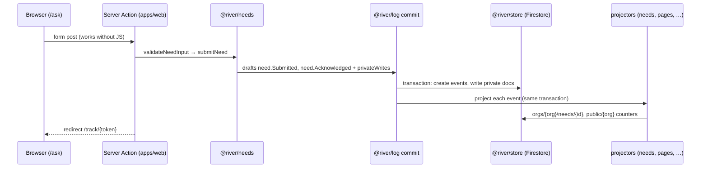
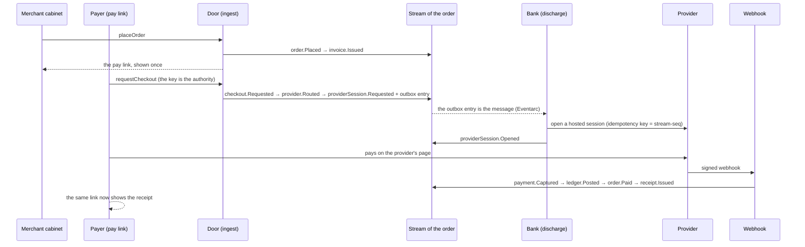

# TOPOLOGY

How the River Portal code is organised, and the rules that keep it ordered. Decisions: `adr/records/ADR-0002 Package Topology and Gates.md` and `ADR-0003 One Public Function per File.md`. The check runs as `npm run topology`, and `node tools/check-topology.mjs --write` regenerates the diagram and table at the end of this file.

## Shape

```
apps/web            Next.js — the PSP portal (ADR-0026): showcase and articles, the pay page, six cabinets, one demo stand in memory
apps/pay-functions  the payment river's functions: one door or one bank per process (PAY_FUNCTION)
infra               Pulumi (TypeScript) — Google Cloud
packages/
  foundation/       ids, language, privacy, who acts,     (layer 0)
    kernel  i18n  privacy  identity  settings             the settings registry
  record/           the append-only log and storage;      (layer 1)
    store  log                                            streams of facts and the functions
    stream  figure                                        around them (ADR-0025)
  river/            the charity portal's write side:      (layer 2)
    needs  gifts  flows                                   needs, gifts, flows (no app mounts it now)
  steward/          the organisation's own configuration  (layer 2)
    config
  assist/           AI assistance (Vertex AI)             (layer 2)
    assist
  pay/              the payment river: vocabulary, ledger, (layer 2)
    pay-facts  pay-ledger  pay-flow  pay-acts             the figure, the door, the banks
    pay-providers                                         (ADR-0025; mounted by apps/pay-functions)
  psp/              payments: orchestration and the PSP   (layer 2)
                    assembly (ADR-0026, ADR-0027)
    psp-facts                                             the vocabulary every boundary shares
    psp-order  psp-invoice  psp-session  psp-payment      the five boundaries
    psp-settlement
    psp-units  psp-access  psp-contracts  psp-risk        the structures assembled around them:
    psp-instruments  psp-split  psp-ledger  psp-flow      structure, access, acquiring terms and tariffs,
    psp-checkout  psp-integration  psp-agents             risk, instruments and issuers, distribution,
                                                          ledger, routing, the pay page, integration,
                                                          the agents
  surface/          what is shown: content, reports,      (layer 3)
    content  reports  feed  pages                         feed, page documents;
    pay-views  psp-views                                  the payment river's and the PSP's readings
  compose/          wiring for applications               (layer 4)
    runtime  pay-runtime  psp-runtime
tools/              topology checker, version picker, design screenshots, development cards (tools/README.md)
spec/ adr/ meta/    Obsidian vaults: product, decisions, process
```

## Rules

1. **One entry point per package: `gate.ts`.** `package.json` `exports` is `{ ".": "./gate.ts" }`, so deep imports fail to resolve. Other packages import only `@river/<name>`.
2. **Dependencies point down or sideways, never up.** foundation ← record ← river/steward/assist/pay/psp ← surface ← compose ← apps. There are no cycles. Every cross-package import is declared in `package.json`.
3. **One public function per file**, named like the file. Data structures live in `types/`, constant data in `data/`. Tests sit next to the code as `*.test.ts`.
4. **Writes are commands, reads are projections.** A command validates its input, builds event drafts and calls `commit`. `commit` appends the events and runs every registered projector in one transaction. Personal data goes to `private` documents through `privateWrites`, never into events.
5. **Pages read page documents.** Public pages read one or two pre-shaped documents (`public/{org}`, `public/{org}/campaigns/{slug}`, …) that the `surface` projectors keep up to date.
6. **Around a stream, functions come in five kinds** (the payment river, `adr/records/ADR-0025`). An *act* turns a gesture into a draft. A *listener* folds the facts it hears into its own state and says when its need is met. A *joiner* emits drafts once every listener it demands is ready. A *controller* carries an intention to the world and answers with drafts. A *reading* folds a stream into a view. Only `settle` writes — the fragment, the state, the views and the outbox, in one transaction — and only a controller reaches outside.
7. **The five payment boundaries hear each other only through the vocabulary** (`adr/records/ADR-0026`, `ADR-0027`). `@river/psp-order`, `@river/psp-invoice`, `@river/psp-session`, `@river/psp-payment` and `@river/psp-settlement` may depend on `@river/psp-facts` and on nothing else in `psp/`; the checker refuses anything more. Each boundary owns a stream per entity (`ord_…`, `inv_…`, `ps_…`, `pay_…`, `stl_…`) and is the only writer of its fact types; any boundary may hear any fact, and its projector folds what it hears into its view. The runtime's one writer (`appendFacts`) refuses a fact written into a stream of another boundary. Everything else in `psp/` assembles structures around the five — and no assembly writes a fact: agents write insights, the ledger is a projection.

## Data flow of one request for help



## Data flow of one payment

One order is one stream. Each arrow into the stream is one wave: one fragment, written in one transaction with the views and the outbox. In the cloud the participants on the right are separate functions; in one process they are calls (`PAY_CARRY=inline`).



## Data flow of one payment session (the PSP)

Five boundaries, a stream per entity; the settlement batch (`stl_…`) follows below for an assembly whose banks settle directly. Four of them carry one payment session: The session's stream is the river; its facts are the bridges, and each bridge forms the views it names in the vocabulary (`factCatalogue.forms`) — of any boundary, and the ledger. One writer appends and projects in the same call; in the demo stand it is `appendFacts` over the world in memory.

```mermaid
sequenceDiagram
  participant M as Merchant (API, cabinet, shop)
  participant Y as Payer (pay link)
  participant A as appendFacts (the one writer)
  participant O as ord_… order
  participant I as inv_… invoice
  participant S as ps_… session (the river)
  participant P as pay_… payment
  participant V as views and the ledger
  M->>A: placeOrder
  A->>O: order.Created (lines, sellers, split plan)
  A->>I: invoice.Issued (amount, due date, hash of the pay key)
  Y->>A: startSession, submitInstrument (the key is the authority)
  A->>S: session.Opened → instrument.Chosen → risk.Scored → route.Chosen
  A->>S: the instrument's course, e.g. authentication.Challenged → authentication.Passed → authorisation.Approved (the payment is born)
  A->>S: capture.Completed → split.Allocated → receipt.Issued → session.Succeeded
  A-->>V: capture makes the invoice and the order paid; the split forms the payment's delta and balanced ledger entries
  M->>A: refundPayment, respond to a dispute; the clock: runPayouts
  A->>P: refund.Completed, dispute.Opened … dispute.Won/Lost, payout.Sent
  A-->>M: webhooks: released facts, id evt_{stream}_{seq}
```

Where the banks settle to the merchant directly (`settlement.model: direct`, the retail assembly of ADR-0027), routing quotes every acquirer under the merchant's acquiring terms before `route.Chosen`; an online order may be captured after picking (`fulfilment.Picked`, `invoice.Adjusted`, a partial `capture.Completed`); the split's fee share is the acquirer's, and the platform pays nothing out. The settlement boundary then holds one batch per provider, unit and business day:

```mermaid
sequenceDiagram
  participant G as The merchant's systems (till, OMS)
  participant B as Provider (acquirer, bonus system)
  participant K as The merchant's bank
  participant A as appendFacts (the one writer)
  participant T as stl_… settlement batch
  participant R as reconciliation and the agents
  G->>A: sales.Reported (count, gross)
  B->>A: settlement.Reported (gross, fee, refunds and chargebacks netted, net, lines by issuer and product)
  K->>A: settlement.Credited (amount, value date, reference)
  A->>T: the batch's view
  T-->>R: three-way reconciliation; the expected fee priced from the acquiring terms, line by line
  R->>A: settlement.Resolved — a person's decision (accepted, claim raised, written off, corrected)
```

## Where data lives (Firestore)

| Path | Visibility | Written by |
|---|---|---|
| `orgs/{org}/events/{id}` | per event | `@river/log` commit (append only) |
| `orgs/{org}/needPrivate/{id}`, `giverPrivate/{id}`, `gratitude/{id}`, `tracking/{hash}` | private | command `privateWrites` |
| `orgs/{org}/needs`, `gifts`, `campaigns`, `flows`, `reports`, `feed`, `content` | team | river / surface projectors |
| `public/{org}` (site document), `public/{org}/campaigns/{slug}`, `public/{org}/reports/{id}`, `public/{org}/feed/{id}` | public | surface projectors |

The payment river keeps its own paths — in the cloud, in its own database (`river-pay`), which only its functions may write:

| Path | Holds | Written by |
|---|---|---|
| `orgs/{org}/streams/{orderId}` and `…/log/{seq}` | the head of a stream and its facts (append only, dense) | `settle` |
| `orgs/{org}/streams/{orderId}/figure/state` | the listeners' state and the joiners' latches — a cache of the stream | `settle` |
| `orgs/{org}/streams/{orderId}/acts/{key}` | markers that make an act or a report enter once | `settle` |
| `orgs/{org}/outbox/{bank}/intentions/{orderId}-{seq}` | an intention waiting for its bank; its creation wakes the bank | `settle`, then `discharge` |
| `orgs/{org}/payOrders/{orderId}` | the order view the cabinets read — a fold of the stream | `settle` (the order reading) |

The PSP (ADR-0026) keeps no path yet. Its demo stand holds the world in memory — streams, views, the ledger's journal, the hierarchy, grants and insights — and rebuilds it on start by replaying a seeded history through the same commands a live payment uses. A store for the PSP is a follow-up; the boundaries need only what `@river/stream` already gives: a stream per key with dense sequence numbers.

## Packages (generated)

<!-- generated:start (node tools/check-topology.mjs --write) -->
```mermaid
flowchart BT
  subgraph foundation
    i18n["@river/i18n"]
    identity["@river/identity"]
    kernel["@river/kernel"]
    privacy["@river/privacy"]
    settings["@river/settings"]
  end
  subgraph record
    figure["@river/figure"]
    log["@river/log"]
    store["@river/store"]
    stream["@river/stream"]
  end
  subgraph river
    flows["@river/flows"]
    gifts["@river/gifts"]
    needs["@river/needs"]
  end
  subgraph steward
    config["@river/config"]
  end
  subgraph assist
    assist["@river/assist"]
  end
  subgraph pay
    pay_acts["@river/pay-acts"]
    pay_facts["@river/pay-facts"]
    pay_flow["@river/pay-flow"]
    pay_ledger["@river/pay-ledger"]
    pay_providers["@river/pay-providers"]
  end
  subgraph psp
    psp_access["@river/psp-access"]
    psp_agents["@river/psp-agents"]
    psp_checkout["@river/psp-checkout"]
    psp_contracts["@river/psp-contracts"]
    psp_facts["@river/psp-facts"]
    psp_flow["@river/psp-flow"]
    psp_instruments["@river/psp-instruments"]
    psp_integration["@river/psp-integration"]
    psp_invoice["@river/psp-invoice"]
    psp_ledger["@river/psp-ledger"]
    psp_order["@river/psp-order"]
    psp_payment["@river/psp-payment"]
    psp_risk["@river/psp-risk"]
    psp_session["@river/psp-session"]
    psp_settlement["@river/psp-settlement"]
    psp_split["@river/psp-split"]
    psp_units["@river/psp-units"]
  end
  subgraph surface
    content["@river/content"]
    feed["@river/feed"]
    pages["@river/pages"]
    pay_views["@river/pay-views"]
    psp_views["@river/psp-views"]
    reports["@river/reports"]
  end
  subgraph compose
    pay_runtime["@river/pay-runtime"]
    psp_runtime["@river/psp-runtime"]
    runtime["@river/runtime"]
  end
  subgraph apps
    web["@river/web"]
    pay_functions["@river/pay-functions"]
  end
  subgraph infra
    infra["@river/infra"]
  end
  assist --> privacy
  pay_runtime --> i18n
  pay_runtime --> pay_acts
  pay_runtime --> pay_providers
  pay_runtime --> pay_views
  psp_runtime --> identity
  psp_runtime --> psp_access
  psp_runtime --> psp_agents
  psp_runtime --> psp_checkout
  psp_runtime --> psp_contracts
  psp_runtime --> psp_flow
  psp_runtime --> psp_ledger
  psp_runtime --> psp_settlement
  psp_runtime --> psp_views
  runtime --> config
  runtime --> pages
  privacy --> kernel
  privacy --> i18n
  settings --> i18n
  settings --> kernel
  pay_acts --> pay_facts
  pay_acts --> stream
  pay_flow --> figure
  pay_flow --> pay_ledger
  pay_ledger --> pay_facts
  pay_providers --> figure
  pay_providers --> pay_facts
  psp_access --> psp_units
  psp_agents --> psp_integration
  psp_agents --> psp_invoice
  psp_agents --> psp_order
  psp_agents --> psp_payment
  psp_agents --> psp_risk
  psp_agents --> psp_session
  psp_checkout --> psp_instruments
  psp_checkout --> psp_units
  psp_contracts --> psp_facts
  psp_facts --> i18n
  psp_facts --> stream
  psp_flow --> psp_instruments
  psp_flow --> psp_risk
  psp_flow --> psp_split
  psp_instruments --> psp_facts
  psp_integration --> psp_facts
  psp_invoice --> psp_facts
  psp_ledger --> psp_facts
  psp_order --> psp_facts
  psp_payment --> psp_facts
  psp_risk --> psp_units
  psp_session --> psp_facts
  psp_settlement --> psp_facts
  psp_split --> psp_facts
  psp_units --> psp_facts
  figure --> stream
  log --> identity
  log --> privacy
  log --> settings
  log --> store
  store --> kernel
  stream --> store
  flows --> needs
  flows --> gifts
  gifts --> log
  needs --> log
  config --> log
  content --> log
  feed --> assist
  feed --> reports
  pages --> feed
  pay_views --> pay_flow
  psp_views --> psp_invoice
  psp_views --> psp_order
  psp_views --> psp_payment
  psp_views --> psp_session
  psp_views --> psp_units
  reports --> content
  reports --> flows
  web --> psp_runtime
  pay_functions --> pay_runtime
```

| Package | Layer | Directory | Purpose | Depends on (@river) | External |
|---|---|---|---|---|---|
| `@river/i18n` | foundation (0) | `packages/foundation/i18n` | Locales, formatters and oblast names with Ukrainian grammatical cases. | — | — |
| `@river/identity` | foundation (0) | `packages/foundation/identity` | Roles, identities and signed demo sessions. | — | — |
| `@river/kernel` | foundation (0) | `packages/foundation/kernel` | Identity, time and small primitives shared by every package. | — | — |
| `@river/privacy` | foundation (0) | `packages/foundation/privacy` | Visibility levels, PII redaction and public pseudonymisation. | kernel, i18n | — |
| `@river/settings` | foundation (0) | `packages/foundation/settings` | The settings registry: typed definitions, three profiles, resolution and validation. | i18n, kernel | — |
| `@river/figure` | record (1) | `packages/record/figure` | Functions around the log: listeners that need, joiners that bridge, controllers at the bank, and the wave that settles them. | kernel, store, stream | — |
| `@river/log` | record (1) | `packages/record/log` | Append-only event log: event envelope, commit with projectors. | identity, kernel, privacy, settings, store | — |
| `@river/store` | record (1) | `packages/record/store` | Document store interface with memory and Firestore drivers. | kernel | firebase-admin |
| `@river/stream` | record (1) | `packages/record/stream` | Append-only streams of facts with dense sequence numbers: one stream per key, one fragment per wave. | store | — |
| `@river/flows` | river (2) | `packages/river/flows` | Flows linking gifts to needs: dispatch, costs, delivery, confirmation, gratitude. | kernel, i18n, privacy, store, log, needs, gifts, settings | — |
| `@river/gifts` | river (2) | `packages/river/gifts` | Campaigns, offers and gifts. | i18n, kernel, log, privacy, settings, store | — |
| `@river/needs` | river (2) | `packages/river/needs` | Needs: intake, triage, status and recipient tracking. | i18n, kernel, log, privacy, settings, store | — |
| `@river/config` | steward (2) | `packages/steward/config` | The organisation's stored settings: profile, overrides, commands and projection. | kernel, log, settings, store | — |
| `@river/assist` | assist (2) | `packages/assist/assist` | AI assistance via Vertex AI (Gemini) with an offline extractive fallback. | kernel, i18n, privacy | @google/genai |
| `@river/pay-acts` | pay (2) | `packages/pay/acts` | The door of the payment river: a person's gesture, validated, becomes a fact — and nothing more. | kernel, pay-facts, stream | — |
| `@river/pay-facts` | pay (2) | `packages/pay/facts` | The vocabulary of the payment river: fact types and their payloads, from the order to the mouth. | — | — |
| `@river/pay-flow` | pay (2) | `packages/pay/flow` | The figure of one payment: points of need (listeners) and bridges (joiners) from the order to the mouth. | figure, kernel, pay-facts, pay-ledger, stream | — |
| `@river/pay-ledger` | pay (2) | `packages/pay/ledger` | The law of conservation for the payment river: commission, balanced double entries and account balances. | pay-facts | — |
| `@river/pay-providers` | pay (2) | `packages/pay/providers` | The bank of the payment river: controllers for Stripe and PayPal, their webhooks, and deterministic stand-ins. | figure, pay-facts, stream | — |
| `@river/psp-access` | psp (2) | `packages/psp/access` | Who may do what, where: roles of the cabinets, grants scoped to a unit and inherited down its subtree, permissions, and separation of duties. | i18n, psp-units | — |
| `@river/psp-agents` | psp (2) | `packages/psp/agents` | The swarm of agents: who watches what, the insights and proposals they write in their own namespace, how they consult each other — and the rule that people decide. | i18n, psp-facts, psp-integration, psp-invoice, psp-order, psp-payment, psp-risk, psp-session, psp-units | — |
| `@river/psp-checkout` | psp (2) | `packages/psp/checkout` | The pay page: its configuration resolved from a unit's policies, card checks that run in the payer's browser, the demo's test cards, and the payer's texts in both languages. | i18n, psp-facts, psp-instruments, psp-units | — |
| `@river/psp-contracts` | psp (2) | `packages/psp/contracts` | Agreements and their terms: the acquiring terms that price a card payment — blended, Interchange++ or an on-us rate — and the PSP's tariffs and fee for one payment, stated before anyone pays. | i18n, psp-facts | — |
| `@river/psp-facts` | psp (2) | `packages/psp/facts` | The shared vocabulary of the platform's payments: the five boundaries, the stages of a payment session, every fact type with its owner and the projections it forms. | i18n, stream | — |
| `@river/psp-flow` | psp (2) | `packages/psp/flow` | The figure of one attempt: the pure decisions that move a session along — screening, routing by strategy, quotes and an approval threshold, the payer's consent, the course of its instrument, the split at capture. | psp-facts, psp-instruments, psp-risk, psp-split, psp-units | — |
| `@river/psp-instruments` | psp (2) | `packages/psp/instruments` | Payment instruments as first-class citizens: each one's family, rail, capabilities, regions and course — the bridges a successful attempt crosses — the providers that carry them, and a directory of card issuers by BIN. | i18n, psp-facts | — |
| `@river/psp-integration` | psp (2) | `packages/psp/integration` | The integrator's side: API keys, webhook endpoints and deliveries — facts released as events — the retry schedule, endpoint health and the API log. | psp-facts | — |
| `@river/psp-invoice` | psp (2) | `packages/psp/invoice` | Boundary: the invoice — the payable claim: how much, by when, how much is still due; its attempts, reminders and receipts. | i18n, psp-facts | — |
| `@river/psp-ledger` | psp (2) | `packages/psp/ledger` | The ledger as a projection: balanced double entries formed from the split, refunds, lost disputes and payouts, and the balances of every account. | psp-facts | — |
| `@river/psp-order` | psp (2) | `packages/psp/order` | Boundary: the order — what is bought, from whom, and how its money will be distributed; its view formed from every fact that concerns it. | i18n, psp-facts | — |
| `@river/psp-payment` | psp (2) | `packages/psp/payment` | Boundary: the payment — money secured by one attempt and its life after the mouth: capture, the delta of shares, refunds, disputes and payouts. | i18n, psp-facts | — |
| `@river/psp-risk` | psp (2) | `packages/psp/risk` | Risk and AML: the scoring of an attempt with its reasons, rules set on units and inherited down the hierarchy, monitoring alerts, merchant onboarding cases and name screening. | i18n, psp-facts, psp-units | — |
| `@river/psp-session` | psp (2) | `packages/psp/session` | Boundary: the payment session — one attempt to pay an invoice, the river from unpaid to paid; its bridges, its stage and how it ended. | i18n, psp-facts | — |
| `@river/psp-settlement` | psp (2) | `packages/psp/settlement` | Boundary: settlement — what the providers, the merchant's own systems and the banks report about a day's batch; its view, and the reconciliation of a batch against what was expected. | i18n, psp-facts | — |
| `@river/psp-split` | psp (2) | `packages/psp/split` | Distribution of one payment into many streams: split plans and templates, the allocation of a captured amount (always summing to it), and the reversal of shares on a refund. | i18n, psp-facts | — |
| `@river/psp-units` | psp (2) | `packages/psp/units` | The hierarchy of organisational units, as in a directory: units, the policies set on them, and the effective policy of every unit — overridden, narrowed, enforced or blocked. | i18n, psp-facts | — |
| `@river/content` | surface (3) | `packages/surface/content` | Editable site content blocks and safe rich-text rendering. | kernel, i18n, store, log | — |
| `@river/feed` | surface (3) | `packages/surface/feed` | Public feed items composed from reports with AI suggestions and human approval. | assist, content, i18n, kernel, log, privacy, reports, store | — |
| `@river/pages` | surface (3) | `packages/surface/pages` | Page documents (projections) shaped for fast public page rendering. | kernel, i18n, privacy, store, log, needs, gifts, flows, reports, feed, content | — |
| `@river/pay-views` | surface (3) | `packages/surface/pay-views` | The surface of the payment river: the order view folded from its stream, the cabinets' readings, the ledger summary and the river of one order. | figure, kernel, pay-facts, pay-flow, pay-ledger, store, stream | — |
| `@river/psp-views` | surface (3) | `packages/surface/psp-views` | What the PSP's cabinets show: the river of one session with what each bridge formed, figures and series for dashboards, funnels by stage, mixes, approvals and payout batches. | psp-facts, psp-invoice, psp-order, psp-payment, psp-session, psp-units | — |
| `@river/reports` | surface (3) | `packages/surface/reports` | Reports generated from flows, edited in the studio, published with consent checks. | content, flows, gifts, i18n, kernel, log, needs, privacy, settings, store | — |
| `@river/pay-runtime` | compose (4) | `packages/compose/pay-runtime` | Wires the payment river for applications and functions: settings from the environment, the doors, the banks, the clock, and the handlers each function runs. | figure, i18n, kernel, pay-acts, pay-facts, pay-flow, pay-providers, pay-views, store, stream | — |
| `@river/psp-runtime` | compose (4) | `packages/compose/psp-runtime` | Wires the platform's two demo assemblies — a retail group whose banks settle to it directly, and a PSP that holds its merchants' money: the worlds in memory, the one writer of facts with its boundary check, the stand-in providers, the history each replays, the commands of every cabinet with their access checks, the readings of routing, cost and reconciliation, the agents and the clock. | i18n, identity, psp-access, psp-agents, psp-checkout, psp-contracts, psp-facts, psp-flow, psp-instruments, psp-integration, psp-invoice, psp-ledger, psp-order, psp-payment, psp-risk, psp-session, psp-settlement, psp-split, psp-units, psp-views, stream | — |
| `@river/runtime` | compose (4) | `packages/compose/runtime` | Wires store driver, projectors and demo seed for applications. | assist, config, content, feed, flows, gifts, i18n, identity, kernel, log, needs, pages, privacy, reports, settings, store | — |
| `@river/web` | apps (5) | `apps/web` | The portal of the payment flow orchestration platform: its showcase and articles, the pay page and the cabinets of two assemblies — a retail group and a PSP — on demo stands. | i18n, identity, psp-access, psp-agents, psp-checkout, psp-contracts, psp-facts, psp-flow, psp-instruments, psp-integration, psp-invoice, psp-ledger, psp-order, psp-payment, psp-risk, psp-runtime, psp-session, psp-settlement, psp-split, psp-units, psp-views | next, react, react-dom, tailwindcss, @tailwindcss/postcss, @types/react, @types/react-dom |
| `@river/pay-functions` | apps (5) | `apps/pay-functions` | The functions of the payment river: one door or one bank per process, chosen by PAY_FUNCTION. | pay-runtime | — |
| `@river/infra` | infra (5) | `infra` | Google Cloud infrastructure for River Portal (Pulumi, TypeScript). The owner runs `pulumi up`. | — | @pulumi/pulumi, @pulumi/gcp, @pulumi/command |
<!-- generated:end -->
