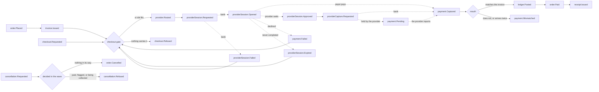
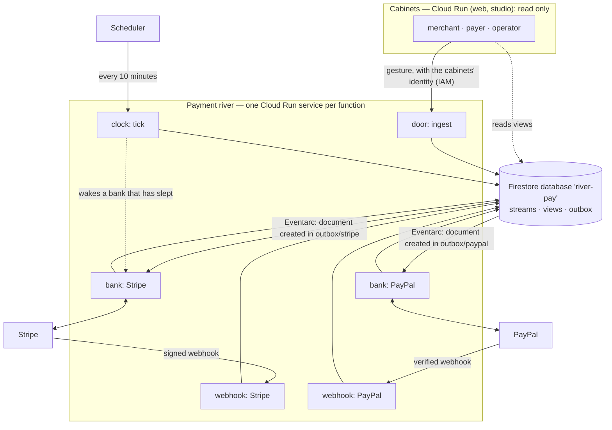

# ADR-0025 Payment River — Functions Around an Append-Only Stream

Built on the branch `new-approach`. Nothing here changes the portal's own thread (needs, gifts, flows); the payment river stands beside it and shares only the store interface, the identity layer and the design language.

## Context
- **The owner's question.** Can the river — banks, a stream, a mouth, tolls, sediment, a surface — carry a *payment*, so that a seller finds a payer and the payer gives and receives in a safe environment? And can the code be built as functions *around a log*, in the manner of the Nest Runtime Specification Set (NestVM), rather than as commands and projectors around aggregates?
- **The owner's frame.**
  - TypeScript functions, clear topology layers, orthogonal parts.
  - `order` as a request for something, `invoice` as the key for payment, `checkout` as the gate to the mouth.
  - The minimal flow: take a payment with a commission and route it to one of the connected external providers (Stripe and PayPal as the examples).
  - Three surfaces: an operator's UI, a merchant's cabinet, a payer's cabinet.
  - It will run as a set of Google Cloud Functions connected by messaging; every system setting lives in `infra/` (Pulumi).
  - "One order — one append-log fragment?"
- **What the portal already has.** One global event log per organisation with synchronous projectors (ADR-0011). That shape suits a thread a coordinator steers. A payment is different: it is steered by nobody. It moves when facts arrive — the payer's word, a provider's answer — and each of those may arrive twice, late, or not at all.

## Decision

### 1. The same geometry, other names
The river's geometry is inherited unchanged; a payment platform only names its parts differently.

| River | NestVM | Payment river | In the code |
|---|---|---|---|
| Left bank: those who ask | — | The merchant, who asks to be paid | `placeOrder` (an act) |
| Right bank: those who give | — | The payer, who gives | `requestCheckout` (an act) |
| Source | a fact entering | `order.Placed` | first fact of a stream |
| A point that needs something | activation knot | order need, checkout gate, approval need, mouth | **listeners** |
| A bridge between points | bind (barrier, one-shot latch) | issue the invoice, open the gate, ask for the capture, settle | **joiners** |
| The bank where the world begins | membrane and controllers | Stripe, PayPal, the clock | **controllers** |
| Toll | — | the commission | `feeMinor`, stated in `invoice.Issued` |
| Mouth | — | capture checked against the invoice, ledger entry, receipt | `settleOrder` |
| Returning tide | — | the receipt | `receipt.Issued` |
| Sediment | wave log | the order's stream | `@river/stream` |
| Surface | readings | the order view, the ledger, the cabinets | **readings**, `@river/pay-views` |
| Stewards | — | the operator | Finance Steward, Administrator; Auditor reads |

### 2. One order is one stream; one wave is one fragment
The answer to the owner's question is **yes, with one refinement**.
- **One order = one stream.** The stream is self-contained and append-only, numbered densely from 0, stored at `orgs/{org}/streams/{orderId}/log/{seq}`. Orders never share a stream, so they never contend, and one order can be read, audited or replayed alone.
- **One wave = one fragment.** A wave starts with what enters from outside — a gesture or a report — and ends when the figure has nothing more to say (quiescence). The whole fragment is written in one transaction. A payment that goes straight through is four fragments; one with a declined attempt and a second provider is eight.
- **Every fact says who gave it.** `origin` is one of three, never confused: a person at the door (`door`), a figure of the machine (`figure`), or the world beyond the bank (`world`, naming the intention it answers when it answers one). `causedBy` links a fact to the one whose propagation produced it.
- Fact types follow `aggregate.PastTense`. Payloads hold no personal data and no card data: the payer is a handle, never a name or an e-mail address (the door refuses `@`); the pay key enters only as a hash.

### 3. Five kinds of function
Each kind may do one thing, and the types make the others impossible.

| Kind | What it is | May | May not |
|---|---|---|---|
| **Act** | A gesture at the door, turned into a draft | validate input, make ids and keys (chance enters here) | read or write the store |
| **Listener** | A point of need: `hears`, `step(state, fact)`, `ready(state)` | fold facts into its own state | see other listeners, emit, do I/O |
| **Joiner** | A bridge: `demands` listeners, fires once per `round` when all are ready, `emit(scope)` | emit drafts from the demanded states | hold state, do I/O, read the clock |
| **Controller** | The bank: `claims` intention types, `discharge(intention, key)` | call the world; answer with drafts | write to the stream itself |
| **Reading** | A surface: `project(view, fact)` | fold a stream into one view document | emit, do I/O |

- **Dependencies** are only what a function declares it hears or demands, plus the assembly that mounts it. There is no service locator and no shared mutable state.
- **Failures are facts — and a guess is not a fact.** A refusal by a provider is an answer (`providerSession.Failed`, `payment.Failed`). A thrown error means "try again". After the last attempt the controller says what the silence means: where nothing can have happened (a page that was never opened) the failure becomes a fact; where the outcome is unknown (a capture: money may have moved) nothing is claimed, and the intention keeps being tried, with the same key, for as long as it takes.
- **An effect is described, then interpreted.** A joiner writes an *intention* (`providerSession.Requested`); a controller carries it out later, elsewhere, possibly more than once.
- **`settle` is the only writer.** In one transaction it writes: the fragment; the listeners' state and the joiners' latches; every view that hears the fragment; an outbox entry for every intention a controller claims; and the act's idempotency marker. All of it or none of it. A wave that would write an intention no mounted controller accepts fails as a whole: an intention must never wait unseen.
- **A decision is taken inside the wave.** What a door or a clock read a moment ago may no longer be true. So a gesture that depends on the state of the order — "withdraw it" — enters as a *request*, and a joiner decides on the stream as it is at that moment. Checks at the door are a courtesy that keeps hopeless requests out of the stream; they are never the decision.
- **`discharge` is safe under overlap.** The same intention may be delivered twice, or by two callers at once. The provider is given the same key; only the first answer enters the stream; and the outbox entry is only ever changed inside a transaction, so a delivery that fails late cannot reopen an intention another delivery has answered.
- **The caches are not the truth.** `foldStream` replays a stream into the state and the views; a test, and the operator's cabinet, check — in one transaction, one moment of the store — that they equal what is stored, and that every intention has its outbox entry, answered exactly where the stream holds its answer.

### 4. The figure of one payment
Six listeners and six joiners (`packages/pay/flow`), all pure. Twenty-one fact types (`packages/pay/facts`).

- **The line:** placed → invoiced → routing → open → (approved) → paid.
- **The branches:** *retry* (an attempt failed; the payer may ask again and another provider is tried first), *refused* (no connected provider carries the order), *flagged* (money arrived that the invoice does not explain, or arrived twice — nothing more is settled, an operator decides), *cancelled* (asked for by the merchant, an operator, or the clock, and decided by the figure).
- **Routing is a pure rule** (`chooseProvider`): the first rule that fits the currency and amount, among the providers the merchant had connected *when the order was placed* — they are written into `order.Placed` — and that this deployment has mounted. The chosen rule's reason is recorded with the choice.
- **The gate is idempotent per attempt.** A failure closes the attempt it names; the same failure reported twice, or a late report about an older session, changes nothing. Asking again beside an open session changes nothing. One fold (`foldAttempt`) is used by the gate, by the point of cancellation and by the order view, so the three cannot disagree about an attempt.
- **Nothing unasked ends an attempt whose money is being asked for.** While a capture intention is unanswered, only its own answer closes the attempt — not an expiry, not a failure a provider reports on its own. The payer is not sent to pay again while the first payment may still arrive. A capture the provider holds as pending is `payment.Pending`: not money, not a failure; the provider reports the outcome itself.
- **A cancellation is a request.** The merchant's or operator's is refused only while a payment is being collected; the clock's — an invoice past its date — also while any attempt is under way, because an invoice does not expire under a payer who is paying it. Paid, flagged and withdrawn orders are not withdrawn.
- **An abandoned page does not hold the order.** Not every provider says when a page was left; after a session's lifetime the clock says so, once for each session, and the payer may ask again. If the payer completes the old page after all, the mouth still recognises the money.
- **Money arriving twice is flagged**, once for each further capture; the same capture told twice — by an answer and by a webhook — is the same money, counted once. An approval that arrives after the order is paid collects nothing.

### 5. What makes it a safe environment
| Property | How | Proved by |
|---|---|---|
| No card data in the river | Provider-hosted checkout only; the river holds a session reference | by construction |
| Nobody pays what was not asked | The capture is compared with the invoice (session, currency, amount, order still standing) before anything is settled | `flow.test.ts` |
| Money is conserved | Every settled payment is one balanced double entry; the commission is taken from the amount, never added | `ledger.test.ts`, the operator's ledger page |
| A webhook is believed only if signed | Stripe: HMAC over the raw body, constant-time, 5-minute tolerance. PayPal: its own verification API | `providers.test.ts`, `runtime.test.ts` |
| A message delivered twice changes nothing | Act keys (`event-<id>`, `answer-<seq>`), per-round latches, per-attempt closure | `figure.test.ts`, `runtime.test.ts` |
| Two deliveries at once change nothing | The outbox entry is read and changed only inside a transaction; the first answer wins and the entry is closed whichever settles first | `figure.test.ts` |
| A capture is never called failed on a guess | An outage on a capture is retried without end, with the same key; pending is reported as pending; "already captured" is read back as captured | `figure.test.ts`, `providers.test.ts`, `runtime.test.ts` |
| No order is withdrawn under a payment | Cancellation is decided inside the wave and refused while money is being collected | `flow.test.ts`, `runtime.test.ts` |
| Nobody is charged twice in silence | An approval after payment collects nothing; a second capture is flagged for an operator | `flow.test.ts` |
| A provider acts once, however often it is asked | The idempotency key is `<stream>-<seq>` of the intention, the same on every retry | `providers.test.ts` |
| An intention is never lost | The outbox entry is written in the same transaction as the intention (no dual write); a wave whose intention nobody mounted accepts is not written; the replay check covers the outbox | `figure.test.ts`, `runtime.test.ts` |
| A misplaced message costs nothing | A bank function without that bank's credentials refuses before an attempt is counted | `runtime.test.ts` |
| The pay key cannot be recovered from the store | Only its SHA-256 is stored; it is shown to the merchant once | `acts.test.ts` |
| A stand-in cannot be used by a stranger | Its page and its outcome need the payer's own authority — the pay key, or being the payer the order is addressed to — checked at the door; a session reference alone opens nothing | `runtime.test.ts` |
| Unsafe configurations do not start | Live credentials without `PAY_ALLOW_LIVE=1`; a stand-in beside a durable store without `PAY_ALLOW_SIMULATED=1`; the memory store in the cloud. A provider nobody declared is a stand-in only in a local river that keeps nothing | `runtime.test.ts` |
| Each function can do only its own harm | One identity and one secret per function; the cabinets cannot write (see 7) | Pulumi program; **not yet deployed** |

### 6. Layers and packages
The layer rule of ADR-0002 is unchanged; `pay` is a new group in layer 2.

| Layer | Package | Holds |
|---|---|---|
| record (1) | `@river/stream` | streams: `Fact`, `Origin`, `readHead`, `commitFacts`, `readStream` |
| record (1) | `@river/figure` | the five kinds, `runWave` (pure), `settle`, `discharge`, `readOutbox`, `rebuildState` |
| pay (2) | `@river/pay-facts` | the vocabulary: twenty-one fact types and their payloads |
| pay (2) | `@river/pay-ledger` | commission, balanced entries, balances |
| pay (2) | `@river/pay-flow` | the figure: listeners, joiners, routing |
| pay (2) | `@river/pay-acts` | the door: validation, `placeOrder`, `requestCheckout`, `cancelOrder` |
| pay (2) | `@river/pay-providers` | the banks: Stripe, PayPal, their webhooks, the stand-ins |
| surface (3) | `@river/pay-views` | the order view, the cabinets' reads, the ledger summary, the river of one order |
| compose (4) | `@river/pay-runtime` | settings from the environment, the assembly, the doors, the clock, the handlers of each function |
| apps (5) | `apps/pay-functions` | the skin: one HTTP server, one handler chosen by `PAY_FUNCTION` |
| apps (5) | `apps/web` | the three cabinets under `/pay` |

`@river/stream` and `@river/figure` know nothing about payments. No external dependency was added: the providers are reached with `fetch`, signatures use `node:crypto`.

### 7. Cut into functions on Google Cloud
The wave is never split: wherever a fact enters, the whole fragment settles in one transaction. What is cut apart are the **doors and the banks** — the places where the river touches something else.

| Function | `PAY_FUNCTION` | Woken by | May be called by | Holds |
|---|---|---|---|---|
| Door | `ingest` | HTTP | the cabinets' service accounts (IAM) | no secret |
| Stripe bank | `discharge` | Eventarc: a document created in `outbox/stripe/intentions` | the wake account and the clock (IAM) | Stripe API key |
| PayPal bank | `discharge` | Eventarc: a document created in `outbox/paypal/intentions` | the wake account and the clock (IAM) | PayPal client id and secret |
| Stripe webhook | `webhook-stripe` | HTTP from Stripe | anyone; believes only signed bodies | Stripe webhook secret |
| PayPal webhook | `webhook-paypal` | HTTP from PayPal | anyone; believes only what PayPal confirms | PayPal credentials and webhook id |
| Clock | `tick` | Cloud Scheduler | the wake account; internal traffic only | no secret; the banks' addresses |

- **The messaging is the outbox.** A joiner's intention and its outbox document are written together. The document's creation is the message: Eventarc delivers a Firestore `document.created` event to that bank's service and retries on a 5xx. Nothing is published after the transaction, so nothing can be written and not sent, or sent and not written.
- **Retries are bounded by the kernel**, not by the messaging layer: `discharge` counts attempts on the outbox entry and, at the third failure, lets the failure enter the stream as a fact. The provider sees the same idempotency key every time.
- **The clock closes what nobody ends.** On each tick it asks for invoices past their date to be withdrawn, and closes provider pages left open longer than a session lives.
- **The clock wakes a bank that has slept.** An intention still in the outbox after five minutes is delivered to its bank again by the clock, in the same shape Eventarc would have used. It is the same intention with the same key, so a late first delivery repeats nothing. An event that can never be carried — not this river's, no such bank — is acknowledged rather than refused, so that it is not delivered again for a day.
- **The door admits four gestures and nothing else** (`parseDoorAct`): place an order, ask to pay, withdraw, and — for a stand-in only — report its outcome. A capture or a ledger entry cannot be said at the door. So a compromised web tier can place and withdraw orders; it cannot credit a merchant.
- **The river has its own Firestore database** (`river-pay`). IAM conditions give the functions read and write there and nowhere else; the cabinets read it; the portal's own write access stops short of it.
- **Packaging.** The functions are Cloud Run services built from one container image (`Dockerfile.pay`) by the existing Cloud Build path (ADR-0014). They are functions in shape — one handler, one trigger, one identity — but not deployed through the Cloud Functions build, because the packages run as TypeScript sources (ADR-0015) in an npm workspace, which a container states exactly and a buildpack would have to be persuaded of. The CloudEvent's document path is read from its headers, so no event library and no protobuf decoding are needed.
- **In one process** (local runs, tests, a single-service deployment) the same functions run without the cut: `PAY_CARRY=inline` carries intentions right after each wave, and the door is a call.

### 8. Settings live in infra
Everything a deployment decides is Pulumi configuration, passed as environment variables and read once at start by `readPayConfig`, which refuses unsafe shapes.

| Pulumi config (`river-portal:`) | Environment | Meaning |
|---|---|---|
| `payEnabled` | — | create the river at all (default: no) |
| `payStripeMode`, `payPaypalMode` | `PAY_STRIPE_MODE`, `PAY_PAYPAL_MODE` | `off`, `simulated`, `connected` |
| `payFeeBps` | `PAY_FEE_BPS` | commission in basis points (250 = 2.5%) |
| `payInvoiceTtlHours` | `PAY_INVOICE_TTL_HOURS` | how long an invoice stands |
| `paySessionTtlMinutes` | `PAY_SESSION_TTL_MINUTES` | how long a provider's page stays open (30 to 1,440; default 180) |
| `payMerchants` | `PAY_MERCHANTS` | merchants, their connected providers and accounts |
| `payRouting` | `PAY_ROUTING` | the routing table, in priority order |
| `payDatabase` | `PAY_FIRESTORE_DATABASE` | the river's Firestore database (default `river-pay`) |
| `payTickSchedule` | — | how often the clock is called |
| `payAllowSimulated`, `payAllowLive` | `PAY_ALLOW_SIMULATED`, `PAY_ALLOW_LIVE` | explicit acceptance of a stand-in in the cloud, or of live money |
| secrets: `payStripeSecretKey`, `payStripeWebhookSecret`, `payPaypalClientId`, `payPaypalSecret`, `payPaypalWebhookId` | Secret Manager → one function each | set by the owner with `pulumi config set --secret` |
| — | `PAY_CARRY`, `PAY_DOOR_URL`, `PAY_BANK_URLS`, `PAY_PUBLIC_URL` | wiring, derived by the Pulumi program |

The operator's *Routes* page shows the settings in force. It does not edit them.

### 9. The cabinets
All three read the same order view; each shows the same five-stage line.
- **Merchant.** Ask for a payment (what for, how much, in which currency, from which payer handle); receive the pay link, shown once; see every order with one sentence that says what happens next; see what is owed after the commission; withdraw an order.
- **Payer.** Needs no account: the pay link is the key to one invoice. The invoice says who asks, for what, and how the amount divides; the one thing the payer can do is offered once and only where it can matter; a paid invoice is its own receipt, at the same link. A signed-in payer also sees their invoices and receipts in one place.
- **Operator.** The river today; what needs attention and why; every order's whole stream, fact by fact, grouped by wave, with the replay check; the ledger with the conservation check; the routes and settings; the outbox.
- **Stand-ins.** A provider mounted as `simulated` is played by the machine under the provider's own name, so routing, the outbox and the stream are exactly as with the real one. Its page is drawn dark, says it is a stand-in, and every fact it gives carries `simulated: true`; the receipt says no money moved. The page opens only for the payer whose session it is.
- **Every page checks for itself.** A layout's redirect does not stop the page beneath it from rendering, and what that page read would travel in the body of the redirect. So each cabinet page establishes who is acting before it reads anything; the actions do so again.

## Consequences
- **Positive**
  - The whole behaviour of a payment is a pure function of its stream. The figure is tested without a store and without a provider; every branch above has a test.
  - Adding a provider is one controller and one or two routing rules. Adding a step is one listener or one joiner; nothing existing is edited.
  - The audit trail is not a by-product: it is the only thing there is. The operator's cabinet shows it as it is stored.
  - The cut into functions follows the model instead of being imposed on it: doors and banks are where a function boundary costs nothing.
- **Negative / costs**
  - **Two log shapes now exist** in the repository: the portal's global log with projectors (ADR-0011) and per-key streams with figures. That is the point of the experiment, and a cost until one of them is chosen.
  - A view is rewritten on every wave that it hears; for an order this is a dozen small writes over its life.
  - Reasons recorded in facts (`provider.Routed.reason`, failure reasons) are English text. The cabinets translate what they can; a provider's own words are quoted as they came.
  - **The pay key is in the address**, as the portal's tracking token is. It therefore appears in the request logs of the load balancer and of Cloud Run; whoever may read those logs can open that one invoice. The page sends no referrer, and the key is stored nowhere.
- **Verified**
  - `npm run check`: types, topology (29 packages), 83 tests — 57 of them new. The production build of the web app passes with the fourteen new routes.
  - Two independent reviews, given the code and not its author's conclusions: one of the cabinets, functions and infrastructure, one of the kernel and the domain. Every finding acted on was first reproduced — by a request against the running app, or by the reviewer's own scenario — and is now a test or a recorded check (`meta/observations/2026-10-02 What Building the Payment River Found.md`).
  - The functions' handlers, in a test that plays the messaging layer: separate runtimes holding separate secrets, one store, Eventarc-shaped deliveries, signed webhooks, an outage, redeliveries.
  - The door function over real HTTP, locally; the image's install stage and start command, rehearsed outside Docker.
  - The three cabinets in the browser, in both languages and at phone width: placing an order, paying by link, a declined attempt, failover to the second provider, the receipt, withdrawal, expiry by the clock, the auditor's read-only view.
- **Not verified — the owner's steps**
  - **Nothing was deployed.** The Pulumi program type-checks; `pulumi preview` and `pulumi up` have not been run. Points to watch on the first run: the Eventarc location for a multi-region database; the Eventarc service agent, which can need a second `pulumi up` after the API is first enabled; the IAM conditions per database; a call from one service to another with an identity token from the metadata server (the door from the cabinets, a bank from the clock).
  - **No request has reached Stripe or PayPal.** Their adapters are written from the public API descriptions and tested against scripted responses only. Their sandboxes are the next step, with test-mode keys set by the owner.
  - PayPal's webhook verification re-serialises the event before asking PayPal; whether PayPal accepts that for every event must be seen in the sandbox.
- **Follow-ups (not built)**
  - Refunds, disputes, payouts to merchants, and reconciliation with a provider's settlement report. `flagged` is where an operator is told; what the operator then does is not yet a figure.
  - Accounts for merchants and payers. Until then the cabinets exist only in demo runs (ADR-0021); the pay link and the operator's cabinet work everywhere.
  - An API for a merchant's own server, with keys — the door function is ready to be its backend.
  - Expiring a provider's session when an order is withdrawn: a payer who completes the page afterwards is charged, and the order is flagged for an operator to return the money.
  - An intention written before its provider was unmounted waits in the outbox, where the operator sees it; the order can be withdrawn, not rerouted.
  - PayPal's `CHECKOUT.PAYMENT-APPROVAL.REVERSED` and every refund and reversal event are not read.
  - The lifetime of a provider's page is one setting for all providers; PayPal's own approval window is assumed, not read from PayPal.
  - The webhooks are public Cloud Run services without Cloud Armor in front (ADR-0009). Bring them behind the load balancer before real traffic.
  - Currencies are assumed to have two decimal places.
  - A choice between the two log shapes, after this experiment is read.

## Alternatives considered
| Option | Why not (now) |
|---|---|
| Put payments in the existing global log, as commands and projectors | It would work, but it would not answer the question asked. A payment is driven by arriving facts, and per-order streams remove contention and make one order replayable alone |
| One Pub/Sub topic per fact type; every function subscribes | Publishing after the transaction is a dual write; ordering per order needs ordering keys; the wave would be smeared over many functions. The outbox gives the same reach with one write |
| Firestore triggers on the log itself (every fact wakes functions) | The figure would run in several places at once; settling to quiescence inside one transaction is the property worth keeping |
| A workflow engine (Cloud Workflows, Temporal) | A second source of truth for where a payment stands. Here the stream is the workflow's state |
| Provider SDKs | Two direct dependencies for six HTTP calls (ADR-0007). `fetch` and `node:crypto` are enough and keep the idempotency key in view |
| Cloud Functions deployed from source (buildpacks) | See 7: TypeScript without a build step, in a workspace, is exact in a container. Nearest variant; revisit if the owner prefers the Functions product surface |
| Elements or card fields on our own page | Card data in the river. Provider-hosted checkout keeps the river out of PCI scope |
| Automatic failover without the payer's word | A failed attempt could loop against a provider that is down. The payer asks again; the river then tries another provider first |
| Cabinets write to Firestore directly, as the portal does | Simpler, and available (`PAY_DOOR_URL` unset). The door function is taken for the cloud so that the exposed tier cannot write a capture |

## Related
- ADR-0002 Package Topology and Gates · ADR-0003 One Public Function per File · ADR-0007 Dependency Supply-Chain Policy
- ADR-0008 Pulumi TypeScript for Infrastructure · ADR-0011 Store Drivers and Synchronous Projections · ADR-0014 Container Builds via Cloud Build from Pulumi · ADR-0015 TypeScript Without a Build Step for Packages
- ADR-0021 Identity Layer and Demo Personas
- `spec/01-business/The River Concept.md`: the geometry
- **Attribution.** The function kinds and the wave — an append-only log, points that declare what they hear, bridges with a barrier and a one-shot latch, a membrane where intentions are answered as facts, readings as folds — adapt ideas from the **Nest Runtime Specification Set** (https://github.com/harmogics/nestvm, licensed CC BY 4.0, https://creativecommons.org/licenses/by/4.0/). Changes: the ideas are re-expressed as plain TypeScript functions over a document store, for one domain; no text and no code of the specification set or of its reference implementation is reproduced here.
- `meta/iterations/Iteration 05 — Payment River.md`: what was built, how it was checked, what was learnt

Back to [[00 ADR Home]].
